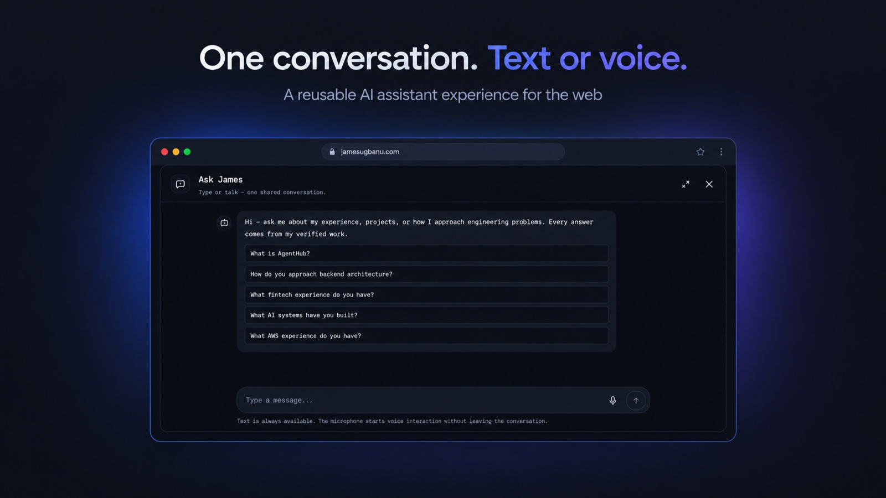

# AI Voice Assistant

**A self-hosted, real-time voice assistant for web applications.**

One conversation. Text or voice.

AI Voice Assistant is James's self-hosted voice layer for a web application. It
adds browser microphone audio, speech recognition, retrieval-grounded
conversation, streamed text-to-speech, and barge-in to an existing backend
without replacing it.



**[Live demo](https://jamesugbanu.com)** · [Quick start](#quick-start) ·
[Integration guide](INTEGRATION.md) · [MIT License](LICENSE)

[Protocol](PROTOCOL.md) · [Configuration](#configuration) ·
[Deployment](DEPLOY.md) · [Security](SECURITY.md)

## What it solves

Most web assistants are text-only. Adding voice means coordinating microphone
capture, turn detection, speech recognition, a knowledge-grounded response, and
streamed speech synthesis. This project packages that voice path as one
self-hosted AI voice assistant service, so an existing RAG API or chat backend
can support spoken conversations without becoming a voice product itself.

Typical uses include adding voice to an existing RAG chatbot or documentation
assistant, self-hosting speech-to-text and text-to-speech for a web app, and
prototyping realtime voice agents with barge-in and streamed audio. The reference
deployment powers `jamesugbanu.com`; the core is reusable with any application
and any HTTP conversational backend.

## Demo

The [live portfolio](https://jamesugbanu.com) demonstrates the user experience:
one Ask James conversation where text and voice share the same history and
context. It is a portfolio deployment, not a standalone hosted demo of this voice
service. This repository documents how to run, configure, and integrate the
service.

> **Project status:** This is a self-hosted reference implementation, not a
> hosted API or managed product. The stdlib test suite covers protocol
> validation, turn orchestration, authentication, quotas, and packaging/privacy
> guards. Model-backed voice quality, Docker images, and the reference
> infrastructure templates require validation in your environment. See
> [Limitations](#limitations). No performance or production-readiness guarantee
> is implied.

- **Audio and turn lifecycle** belong to this service. It never stores your
  knowledge base and does not need your application's database.
- **The portfolio RAG integration is retained** as the default backend adapter.
  Existing endpoints, payloads, audio formats, and environment variables are
  unchanged.
- **Other backends are supported** through a small HTTP/SSE responder
  (`VOICE_RESPONDER=http`) or by implementing the same interface in-process.

## Features

- Realtime voice calls: 16 kHz PCM16 in, 24 kHz PCM16 streamed out.
- Silero VAD, faster-whisper STT, Pocket TTS (preset or authorized cloned voice).
- Incremental partial transcripts (internal hypotheses; only the final one is
  used) and deterministic greeting fast path.
- Barge-in: sustained speech during playback cancels the current turn; a manual
  interrupt event does the same.
- Composer dictation (`POST /v1/transcribe`) and read-aloud
  (`POST /v1/tts`) reuse the loaded models, with short-lived HMAC tickets.
- Per-session history, bounded conversation context, session quotas, and
  turn-level cancellation.
- Optional portfolio voice booking adapter (availability → slot → details →
  explicit confirmation → provider result); never announces uncertain bookings.
- Generic HTTP backend adapter with SSE streaming, timeouts, and cancellation.
- SQLite sessions/quotas in one process; no external database.

## How it works

```
browser mic ── WS / PCM16 16 kHz ──▶ voice service
                                    │ Silero VAD
                                    │ faster-whisper STT
                                    │ turn state + history
                                    ▼
                         responder (portfolio RAG or your HTTP backend)
                                    │ streamed text
                                    ▼
                         segmentation → Pocket TTS
                                    │
browser speakers ◀── WS / PCM16 ────┘
```

1. `POST /v1/sessions` returns a short-lived session id, HMAC ticket, and
   `ws_url`.
2. The browser opens `/v1/voice`, sends `hello`, then 100 ms audio frames and
   `end_utterance`.
3. The service transcribes, calls the responder with the utterance and recent
   history, and streams synthesized audio back as `audio_frame` events.
4. `turn_end` closes the turn; `interrupt` cancels in-flight STT/RAG/TTS work.
5. `end_session` releases the session and quota.

The full message reference is in [`PROTOCOL.md`](PROTOCOL.md). Backend
contracts are in [`INTEGRATION.md`](INTEGRATION.md).

## Technology stack

| Layer | Implementation |
|---|---|
| API and transport | FastAPI, Uvicorn, WebSocket, PCM16 audio |
| Speech recognition | faster-whisper on CPU, Silero VAD |
| Speech synthesis | Pocket TTS: preset voice or authorized cloned voice |
| Conversation | Portfolio RAG adapter (default) or a generic HTTP/SSE responder |
| Session state | SQLite, HMAC session tickets, optional scoped widget tokens |
| Packaging | Docker, Docker Compose, optional Terraform reference infrastructure |

The stack is self-hosted and CPU-first: no hosted voice API, external database,
or GPU is required for the reference path.

## Requirements

- Python **3.11+** (tested with 3.12) for the service.
- Optional Docker (the repository includes a CPU-only image and Compose files).
- `ffmpeg` and `libsndfile1` for audio decoding/reference preparation.
- Model weights: roughly 5 GB on first run (faster-whisper, Silero VAD, Pocket
  TTS). They are downloaded to `HF_HOME`/`XDG_CACHE_HOME` and reused.
- Memory: about 1.3–1.5 GB with one loaded model per backend. CPU inference;
  no GPU is required or claimed.
- A conversational backend (the portfolio RAG API or your own HTTP/SSE
  endpoint) and, for browser clients, an allowed origin.

## Quick start

### 1. Install

```bash
python3.12 -m venv .venv
. .venv/bin/activate
# Linux CPU-only: avoids multi-GB CUDA wheels. On macOS, skip this line and use
# the standard wheel installed by `pip install -e .`.
pip install --index-url https://download.pytorch.org/whl/cpu torch
pip install -e .
```

For the offline stub demo you only need the web dependencies:

```bash
pip install fastapi 'uvicorn[standard]' httpx
```

### 2. Configure

```bash
cp .env.example .env
```

Set at least `VOICE_HMAC_SECRET` and one backend:

- `VOICE_RESPONDER=portfolio` + `VOICE_RAG_API_URL` + `VOICE_RAG_SERVICE_TOKEN`
- or `VOICE_RESPONDER=http` + `VOICE_RESPONDER_URL`

The service validates required settings at startup and fails with an actionable
message instead of silently disabling an integration. See
[Configuration](#configuration).

### 3. Models

Real models download automatically on the first startup (several minutes).
To try the protocol without models, set `VOICE_USE_STUBS=1`. Stubs are
deterministic and are **not** a substitute for recognition testing.

Cloned TTS requires the gated `kyutai/pocket-tts` weights, `HF_TOKEN`, and an
authorized reference (`VOICE_TTS_MODE=clone`, `VOICE_TTS_VOICE_REF`). The
default `preset` mode needs neither.

### 4. Start

```bash
uvicorn app.main:app --host 127.0.0.1 --port 8000
curl -fsS http://127.0.0.1:8000/healthz
```

`/healthz` reports `db`, `warm`, and the resolved TTS mode. `/v1/sessions`
waits for warm-up before answering.

### 5. Tests

```bash
python -m unittest discover -s tests
python -m py_compile app/*.py tests/*.py examples/*.py
```

The unit suite is stdlib-only and needs no model packages. It covers protocol
validation, turn orchestration/cancellation, auth, quotas, STT guards, VAD
policy, segmentation, the generic responder, and packaging/privacy guards.

### 6. Try it without the portfolio

```bash
python examples/echo_backend.py --port 9000 &
# in .env: VOICE_RESPONDER=http
#          VOICE_RESPONDER_URL=http://127.0.0.1:9000/respond
#          VOICE_USE_STUBS=1
uvicorn app.main:app --host 127.0.0.1 --port 8000 &
python examples/voice_client.py --base http://127.0.0.1:8000 \
  --text "Tell me about this service" --text "What did I just say?"
```

See [`examples/README.md`](examples/README.md) for audio turns, saving
synthesized audio, and seeding history.

### 7. Container image

Pushes to `main` publish a `linux/amd64` image to GitHub Container Registry:

```text
ghcr.io/jamesugbanu/ai-voice-assistant:<full-commit-sha>
ghcr.io/jamesugbanu/ai-voice-assistant:latest
```

The image is built from a clean checkout, so it never contains `.env`, private
reference audio, or model weights. Clone mode still needs the authorized
reference mounted read-only and `HF_TOKEN` supplied at runtime. If the package
is private, authenticate first with `docker login ghcr.io`.

## Configuration

| Variable | Required | Purpose |
|---|---|---|
| `VOICE_HMAC_SECRET` | yes | Signs session/dictation tickets. Use 32+ random bytes. |
| `VOICE_RESPONDER` | no | `portfolio` (default) or `http`. |
| `VOICE_RAG_API_URL` / `VOICE_RAG_SERVICE_TOKEN` | portfolio | Existing portfolio RAG endpoint and bearer token. |
| `VOICE_RESPONDER_URL` / `VOICE_RESPONDER_TOKEN` | http | Your backend URL and optional bearer token. |
| `VOICE_ALLOWED_ORIGINS` | no | Exact browser origins, comma-separated. No wildcards. |
| `VOICE_PUBLIC_BASE_URL` | no | Origin used to build `ws_url` (`https://` in production). |
| `VOICE_STT_MODEL` | no | faster-whisper checkpoint (default `base.en`). |
| `VOICE_TTS_MODE` | no | `preset` (default) or `clone`. |
| `VOICE_TTS_VOICE_REF` | clone | In-container path to the authorized reference. |
| `VOICE_DB_PATH` | no | SQLite path (default `data/voice.sqlite3`). |
| `VOICE_MAX_CALL_SECONDS` | no | Hard call limit (default 300). |
| `VOICE_DAILY_ALLOWANCE_SECONDS` | no | Per-visitor daily allowance (default 600). |

The complete list, defaults, and optional tuning knobs are documented in
[`.env.example`](.env.example) and `app/config.py`. Secrets belong in `.env`
(local) or your secret manager; `.env` is Git-ignored.

## Integration

### Frontend

Use the documented REST + WebSocket protocol (`PROTOCOL.md`). The browser needs
to capture 16 kHz mono PCM16, send 100 ms frames, and schedule returned PCM16
chunks. The reference frontend is the portfolio's Ask James panel; it is not
required to use this service. Any client that speaks the protocol can connect.

### Your own conversational backend

Set `VOICE_RESPONDER=http` and implement:

```http
POST /respond
Content-Type: application/json

{"question": "...", "history": [{"question": "...", "answer": "..."}], "sessionId": "..."}
```

```text
event: token
data: {"text": "answer text "}

event: done
data: {}
```

Emit `event: error` with a safe message to fail the turn. The service cancels
the request when the visitor interrupts or the call ends. Booking is optional
and is implemented only by the portfolio adapter; a generic backend does not
need to support it. See [`INTEGRATION.md`](INTEGRATION.md) for the full
contract and `examples/echo_backend.py` for a runnable implementation.

### Existing portfolio integration

The portfolio adapter is the default and is preserved:

- `app/rag_client.py` calls the existing `POST /api/rag` SSE contract with
  `mode: "voice"`, `history`, and `timeZone`.
- `app/booking.py` handles the optional portfolio booking conversation and
  calls `/api/booking` only after an explicit confirmation.
- Endpoint names, WebSocket events, audio formats, authentication, origin
  checks, quotas, and environment variables are unchanged. Existing portfolio
  deployments keep working with `VOICE_RESPONDER` unset (default `portfolio`).

## Repository layout

```
app/            service: transport, sessions, STT/VAD/TTS, turns, responder
tests/          stdlib unittest suite (no model packages)
examples/       runnable echo backend + WebSocket client
scripts/        reference preparation, benchmarks, release/deploy helpers
deploy/         reference deployment templates (portfolio-specific; adapt)
infra/          optional Terraform for a disposable host (portfolio-specific)
voice-reference/ private recordings (Git-ignored); only the README is tracked
Dockerfile      CPU-only, non-root image (clone reference optional)
docker-compose.yml / .local.yml   single-host and local-dev shapes
PROTOCOL.md     browser ↔ server protocol
INTEGRATION.md  backend contracts (generic + portfolio)
DEPLOY.md       reference deployment notes (portfolio-specific)
```

## Security and privacy

- Short-lived HMAC tickets; no JWT library and no server-side ticket lookup.
- Optional project-scoped widget tokens are verified at session creation
  (expiry, audience, scope, origin, project); a valid token scopes session and
  attempt identifiers to its project. `anonymous` mode preserves the existing
  portfolio flow.
- Exact origin allowlist; missing `Origin` is accepted for non-browser clients.
- Per-IP attempt and endpoint budgets, bounded frames/turns/messages, one
  active session per visitor, and a single worker with in-process model
  singletons.
- Audio and transcripts are not persisted by default. Diagnostic capture is
  opt-in and local-only (`VOICE_DIAG_CAPTURE_DIR`).
- The container runs as a non-root user. Secrets are never logged.
- Private voice references and staging directories are Git-ignored. Do not
  commit or publish a voice recording you are not authorized to use.

## Limitations

- Answer latency follows the conversational backend; voice starts at the first
  speakable segment and does not wait for the whole answer.
- All inference is CPU-bound and serialized per backend on a small host. The
  service is designed for a single uvicorn worker; in-process rate limiters and
  model singletons assume that.
- Dependency versions are floors, not a lockfile. Pin the built image/digest
  for reproducible deployments.
- Recognition quality follows microphone quality. Nigerian-English, Pidgin, and
  other accent accuracy is not claimed as validated.
- Booking is a portfolio adapter capability, not a core requirement.
- Cloned TTS depends on gated model weights and an authorized reference; the
  preset voice is the portable default.
- Docker and infrastructure files are provided but are not exercised by the
  stdlib test suite; see `DEPLOY.md` for the reference deployment.

## License

MIT — see [`LICENSE`](LICENSE).
